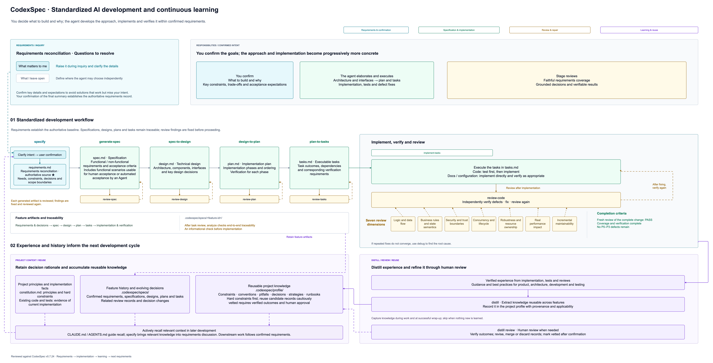

<div align="center">
  <picture>
    <source media="(prefers-color-scheme: dark)" srcset="codexspec-logo-dark.svg">
    <source media="(prefers-color-scheme: light)" srcset="codexspec-logo-light.svg">
    
  </picture>
</div>

<h1 align="center">CodexSpec</h1>

<p align="center">
  <b>English</b> | <a href="README.zh-CN.md">中文</a> | <a href="README.ja.md">日本語</a> | <a href="README.es.md">Español</a> | <a href="README.pt-BR.md">Português</a> | <a href="README.ko.md">한국어</a> | <a href="README.de.md">Deutsch</a> | <a href="README.fr.md">Français</a>
</p>

<p align="center">
  <a href="https://pypi.org/project/codexspec/"></a>
  <a href="https://pypi.org/project/codexspec/"></a>
  <a href="https://opensource.org/licenses/MIT"></a>
</p>

<p align="center">
  <strong>A Requirements-First SDD toolkit for Claude Code and OpenAI Codex</strong>
</p>

CodexSpec turns confirmed requirements into traceable specifications, designs,
plans, tasks, and implementations. You decide **what** to build and **why**;
the agent develops **how** within those confirmed requirements, using review
checkpoints and persistent project knowledge.

Use it through Claude Code slash commands, Codex skills, or both. Ordinary
features use separate Git worktrees by default, and an optional shared blueprint
lets the agent develop a queue of confirmed requirements autonomously.

[📖 Documentation](https://zts0hg.github.io/codexspec/) | [中文文档](https://zts0hg.github.io/codexspec/zh/) | [日本語ドキュメント](https://zts0hg.github.io/codexspec/ja/) | [한국어 문서](https://zts0hg.github.io/codexspec/ko/) | [Documentación](https://zts0hg.github.io/codexspec/es/) | [Documentation](https://zts0hg.github.io/codexspec/fr/) | [Dokumentation](https://zts0hg.github.io/codexspec/de/) | [Documentação](https://zts0hg.github.io/codexspec/pt-BR/)

## Table of Contents

- [Why Choose CodexSpec?](#why-choose-codexspec)
- [30-Second Quick Start](#30-second-quick-start)
- [Installation](#installation)
- [Core Workflow](#core-workflow)
- [Shared Blueprint and Autonomous Development](#shared-blueprint-and-autonomous-development)
- [Worktree Development](#worktree-development)
- [Work with Existing Code](#work-with-existing-code)
- [Review and Debugging](#review-and-debugging)
- [Project Knowledge](#project-knowledge)
- [Git Workflow](#git-workflow)
- [Available Commands](#available-commands)
- [Configuration and Internationalization](#configuration-and-internationalization)
- [Project Structure](#project-structure)
- [Extension Materials](#extension-materials)
- [Development](#development)
- [Contributing](#contributing)
- [License](#license)

## Why Choose CodexSpec?

| Need | What CodexSpec provides |
|------|-------------------------|
| Clear product intent | Explicit confirmation and a persistent `requirements.md` before specification |
| Traceable development | Source links through requirements → spec → design → plan → tasks |
| Reviewable decisions | Four artifact review commands, cross-artifact analysis, and a separate code defect gate |
| Session and team continuity | Feature records, project principles, reusable knowledge, and relevant historical decisions |
| Multiple features in progress | One Git worktree per ordinary feature, with stable workspace reuse |
| More automation | Optional stage advancement and autonomous development of confirmed blueprint requirements |
| Team language preferences | Independent interaction, document, and commit languages |

### What is Requirements-First SDD?

Requirements-First Spec-Driven Development makes **confirmed requirements the
highest-priority feature authority**. The agent records goals, constraints,
decisions, exclusions, open questions, and confirmation evidence before deriving
the implementation artifacts.

```text
Idea → Confirmed Requirements →     Spec    →     Design    →     Plan    →    Tasks     →     Code
                 ↓                   ↓              ↓              ↓             ↓              ↓
         User confirmation      review-spec   review-design   review-plan   review-tasks   review-code
```

You confirm the requirements; each derived artifact has its own review, from
specification through code.

Human collaboration establishes and changes product intent. Automatic reviews
check derived artifacts against it. Enabling automation advances work through
passing stages; it does not let the agent silently replace confirmed requirements.

<!-- workflow-diagram:start -->
<picture>
  <source media="(prefers-color-scheme: dark)" srcset="assets/workflow/workflow-en-dark.png">
  
</picture>

View full size: [☀️](assets/workflow/workflow-en-light.png) · [🌙](assets/workflow/workflow-en-dark.png)
<!-- workflow-diagram:end -->

## 30-Second Quick Start

Install CodexSpec and initialize for the assistant you use:

```bash
uv tool install codexspec

# Create a new project for Claude Code
codexspec init my-project --ai claude

# Or initialize an existing project for Codex
cd your-existing-project
codexspec init . --ai codex

# Use --ai both when you want both integrations
```

Start your installed assistant in the initialized project. The same workflow
uses these two invocation forms:

| Assistant | Start requirements discovery |
|-----------|------------------------------|
| Claude Code (`claude`) | `/codexspec:specify I want to build a todo application` |
| Codex (`codex`) | `$codexspec:specify I want to build a todo application` |

Customize project principles with `constitution` when needed. Confirm the final
requirements summary, then continue using the returned feature directory and
workspace. See [Core Workflow](#core-workflow) for the remaining commands.

Using the Codex desktop app? [Ask Codex to install and initialize your project](#install-with-the-codex-desktop-app).

## Installation

### Install with the Codex Desktop App

You can ask Codex to install CodexSpec and set up your project directly from the desktop app.

1. Add a local project in the Codex desktop app and select the folder where you want to work.
2. Start a chat in that project and paste the prompt below.
3. If the app requests permission to download or install dependencies, approve the requested action to continue.

```text
Please install and initialize CodexSpec in the current project.
Project: https://github.com/Zts0hg/codexspec

Complete the setup directly instead of asking me to run terminal commands.

Check the environment. If uv or Python 3.11+ is missing, install the required
tools in my user directory using their official installation instructions.
Install the latest stable release of CodexSpec.

For a new setup, initialize the current project for Codex in English:
codexspec init . --ai codex --lang en

If CodexSpec is already configured, check its version and configuration before
updating. Preserve existing requirements, project principles, user files,
and configuration settings.

Verify that the CLI works and that AGENTS.md and the CodexSpec skill files
under .agents/skills/ are installed. Explain the result and how to start
describing my requirements in plain English. If the skills are not yet
available in this chat, tell me whether to start a new chat or restart the app.
```

For Chinese replies and documents, replace `--lang en` with `--lang zh-CN` and ask Codex to explain the result in Chinese.

Codex installs the same CLI and project skills used by the manual setup below. You can start using them with a prompt such as `$codexspec:specify I want to build a todo application`. See [OpenAI's skills guide](https://learn.chatgpt.com/docs/build-skills) for local skill discovery and refresh behavior.

### Prerequisites

- Python 3.11+
- [uv](https://docs.astral.sh/uv/) (recommended), or pip
- The assistant you intend to use: Claude Code or Codex
- Git for worktree development and Git workflows

### CLI Installation

```bash
uv tool install codexspec

# Or use pip
pip install codexspec

# Verify the CLI and inspect available commands
codexspec version
codexspec --help
codexspec list-commands
```

Initialize a new project with `codexspec init my-project --ai claude`,
or the current directory with `codexspec init . --ai codex`. Use `--ai both`
for both integrations. The assistant selection defaults to `claude`; choose
the value explicitly for Codex or both.

<details>
<summary>Alternative installation methods</summary>

#### One-time initialization

```bash
uvx codexspec init my-project --ai claude
uvx codexspec init . --ai codex
```

One-time initialization installs project commands and the standalone commit
runtime. Worktree routing, blueprint/auto-dev, and manual profile review still
invoke the CodexSpec CLI; make it available for those workflows.

#### Development versions

```bash
uv tool install git+https://github.com/Zts0hg/codexspec.git
uv tool install git+https://github.com/Zts0hg/codexspec.git@main

# Replace <tag> with the version you want
uv tool install git+https://github.com/Zts0hg/codexspec.git@<tag>
```

</details>

<details>
<summary>Windows installation</summary>

Use PowerShell:

```powershell
powershell -c "irm https://astral.sh/uv/install.ps1 | iex"
# Restart PowerShell, then:
uv tool install codexspec
codexspec version
```

See the [Windows Troubleshooting Guide](docs/en/WINDOWS-TROUBLESHOOTING.md)
for PATH and installation troubleshooting.

</details>

### Upgrade and Refresh a Project

Updating the CLI and refreshing a project's installed commands are separate steps:

```bash
uv tool install codexspec --upgrade
# Or: pip install --upgrade codexspec

# In the project you want to refresh; select its desired integration(s)
codexspec init . --force --ai both
```

Use `--ai claude` or `--ai codex` when only that integration is wanted.
`--force` regenerates distributed commands/scripts and refreshes review resources;
it also auto-confirms migration, command-update, and constitution-compliance prompts. Existing requirements and project
principles are retained, existing context-file bodies are preserved while managed
guidance is updated, and configuration keys you did not explicitly set are kept.

The planning command is `design-to-plan`; installation updates retire the old
`spec-to-plan` entry without an alias.

### Plugin Marketplace Installation

For Claude Code, install the plugin from its marketplace:

```text
/plugin marketplace add Zts0hg/codexspec
/plugin install codexspec@codexspec-market
/codexspec:config
```

The plugin supplies commands and session-start guidance for staged commit
analysis and historical requirements recall, including resumed sessions.
Plugin installation does not initialize a project. Use `/codexspec:config`
to create or modify language, workflow, and review settings; use CLI initialization
when you need the full project scaffold.

Direct commit preview and authorized in-place commits can use the bundled
runtime with Python 3.11+ and Git, without a persistent CodexSpec CLI.
Worktree routing, blueprint/auto-dev, and manual profile review retain their CLI
requirements. The plugin startup hook requires Git on PATH and a Claude Code
version supporting command-hook `args` (exec form). Its guidance is for the agent;
it does not intercept manual Git commands.

See [Installation](docs/en/getting-started/installation.md) for detailed setup.

## Core Workflow

The standard feature workflow preserves a source-linked chain:

```text
/specify          → requirements.md
/generate-spec    → spec.md       → review-spec
/spec-to-design   → design.md     → review-design
/design-to-plan   → plan.md       → review-plan
/plan-to-tasks    → tasks.md      → review-tasks → analyze
/implement-tasks  → implementation and complete-feature code review
```

Examples below use Claude's `/codexspec:` prefix. In Codex, use
`$codexspec:` with the same command name and arguments.

| Step | Command | Purpose and output |
|------|---------|--------------------|
| Project principles | `/codexspec:constitution` | Create/update `constitution.md` and validate affected artifacts |
| Requirements | `/codexspec:specify <idea>` | Discuss intent, confirm a final summary, and persist `requirements.md` |
| Specification | `/codexspec:generate-spec <feature-dir>` | Compile confirmed requirements into `spec.md` with source references |
| System design | `/codexspec:spec-to-design <feature-dir>` | Produce `design.md`: components, interfaces, and key design decisions |
| Implementation plan | `/codexspec:design-to-plan <feature-dir>` | Produce `plan.md`: phases, ordering, and verification |
| Tasks | `/codexspec:plan-to-tasks <feature-dir>` | Produce traceable, verifiable `tasks.md`; run cross-artifact analysis |
| Implementation | `/codexspec:implement-tasks <feature-dir>` | Execute tasks, verify outcomes, and repair independently verified review findings |

Replace `<feature-dir>` with the feature directory returned during discovery.
Continue in its worktree or pass its explicit path; this retains the same feature
identity across commands and sessions.

### specify, clarify, and analyze

- **specify** starts or revisits requirement discovery. Only explicit confirmation
  makes the requirement summary binding.
- **clarify** resolves ambiguity in existing requirements/specification: up to five
  questions per run across four categories. It updates `requirements.md` first,
  then synchronizes `spec.md`.
- **analyze** checks the complete requirements → spec → design → plan → tasks
  chain. It automatically applies deterministic fixes to downstream artifacts
  when their correction follows from upstream authority; it never edits
  `requirements.md`. Unresolved findings are reported. It runs automatically after
  a passing task review and is informational rather than an implementation gate.

```text
/codexspec:clarify <feature-dir>
/codexspec:analyze <feature-dir>
```

### Small Changes with Quick

Use `quick` for a small, well-bounded change such as a localized fix:

```text
/codexspec:quick Fix the empty-state message on the task list
```

Quick confirms and persists a compact requirement summary, then orchestrates
specification, planning, tasks, and implementation with the generation commands'
reviews. Broad changes or unresolved product/design choices call for the standard
workflow; Quick pauses when it needs a new decision.

### Workflow Automation

`workflow.auto_next` defaults to **false**. When it is `true` in the active
workspace's configuration, final requirement confirmation advances to
specification. Each generation stage advances after `PASS` or
`PASS_WITH_WARNINGS`; `NEEDS_REVISION` or `BLOCKED` stops the chain.
`implement-tasks` is terminal.

Automatic artifact repair is limited to verified defects whose correction
follows from upstream evidence, with at most two fix-and-review rounds.
Advisories remain separate. The implementation review/repair loop has its own
completion rules described below.

See the [workflow guide](docs/en/user-guide/workflow.md) for detailed contracts.

## Shared Blueprint and Autonomous Development

Use `blueprint` when you want to prepare several confirmed requirements before
development, and `auto-dev` to develop that queue:

```text
/codexspec:blueprint Add a confirmed requirement for task reminders
/codexspec:auto-dev
```

Blueprint discovery resolves user-owned direction, choices, and constraints
before a requirement enters the queue. The shared `.codexspec/blueprint.md`
uses `pending`, `in_progress`, and `completed` states. You can append,
replace, delete, or reorder pending requirements; active and completed entries
are read-only to blueprint maintenance.

Auto-dev follows document order, resumes an in-progress feature before starting
another, and re-reads the queue after each completion so newly appended pending
work can join the run. It performs the SDD stages, implementation, verification,
review, and repair within the confirmed requirements. Calling `auto-dev` enables
its automation independently of `workflow.auto_next` and does not change that setting.

Both commands share `worktree-for-codexspec-auto-dev` on branch
`codexspec/auto-dev`. They can operate concurrently under the shared ownership
and write protections; requirements are developed sequentially in that workspace.
Product decisions that cannot be resolved from confirmed requirements stop the run
with evidence rather than prompting during normal autonomous execution.

Inspect the current shared blueprint without changing it:

```bash
codexspec show-blueprint
```

## Worktree Development

A Git worktree is another working directory for the same repository, with its own
checked-out branch. CodexSpec uses one per ordinary feature by default, creating
it before the first requirement write and keeping that feature's documents,
implementation, tests, and repairs together.

```text
projects/
├── my-project/
└── my-project-codexspec-worktrees/
    ├── <feature-id>-task-reminders/
    ├── <feature-id>-search/
    ├── worktree-for-codexspec-maintenance/
    └── worktree-for-codexspec-auto-dev/
```

Continuing a feature reuses its workspace. Standalone configuration, constitution,
and profile changes use the maintenance worktree; changes made in an active feature
stay there. Configuration is **checkout-local**: a setting changed in a routed
worktree takes effect there first, and reaches other checkouts through Git
integration. Run CLI commands and checks in the returned workspace.

New feature baselines compare committed local and fetched remote main-branch
history by Git ancestry. Divergent histories merge inside the new worktree and
require verification. A failed fetch warns and permits locally available refs;
creation failures do not fall back to writing in the main checkout.

`workflow.worktrees` defaults to **true**; only literal YAML `false` disables
ordinary feature and maintenance isolation. Blueprint/auto-dev keep their fixed
shared worktree either way. Initialization and installation updates operate on
the checkout you explicitly select. Completed worktrees are retained; completion
does not automatically merge or delete them.

See [Worktree Development](docs/en/user-guide/workflow.md#worktree-development)
and [configuration](docs/en/reference/configuration.md#workflowworktrees).

## Work with Existing Code

Two entry points serve different goals:

| Command | Use it to | Output/boundary |
|---------|-----------|-----------------|
| `onboard [path]` | Seed reusable project knowledge from an existing codebase | Candidate conventions and narrowly evidenced constraints in the profile; code remains read-only |
| `reverse-spec [path]` | Understand existing architecture or compare code with confirmed intent | Draft artifacts or a drift report; code remains read-only |

```text
/codexspec:onboard src/
/codexspec:reverse-spec
/codexspec:reverse-spec src/auth
```

Onboard infers conventions from observable code and proposes constraints only
from explicit prohibitions. Convention candidates take local effect immediately;
constraint candidates require an in-session persist/edit/drop decision.
It preserves existing knowledge and does not invent past decision rationale or
experiential pitfalls from a cold scan.

Reverse-spec has three modes:

- **Overview**: no path, or repository root, produces a thin architecture
  `design.md` and `slices.md` for choosing modules to inspect.
- **Generate**: a module path without a confirmed baseline produces draft
  `spec.md`, `design.md`, and open/inferred requirements.
- **Reconcile**: a module with a confirmed baseline produces `reconcile.md`,
  reporting undocumented behavior, unimplemented specifications, and semantic
  mismatches against confirmed spec/design, with requirements governing intent.

Inferred drafts require human confirmation before becoming a baseline.
Reconciliation reports the proposed direction—fix code, update documents, or
decide intent—and does not automatically apply it.

## Review and Debugging

Four artifact reviewers check fidelity, coverage, feasibility, and internal
quality: `review-spec`, `review-design`, `review-plan`, and `review-tasks`.
They run automatically after generation and can also be invoked manually.
Reports distinguish verified defects from non-gating risk advisories and design
opportunities, with a compatibility score.

`review-code` provides a separate change-scoped defect gate and an explicit
whole-code quality assessment:

```text
/codexspec:review-code --feature <feature-dir>
/codexspec:review-code --uncommitted
/codexspec:review-code --audit src/
```

Default review covers the complete feature-branch delta, including committed,
staged, unstaged, and untracked non-ignored changes. You can explicitly select
committed, uncommitted, or one-commit evidence. `--feature` attaches requirements
context without narrowing Git scope. `--audit` assesses the named paths and
produces an advisory scorecard rather than a completion verdict.

Reviews load shared standards from `.codexspec/review-code/`, selecting relevant
behavior dimensions and language/framework checks. Findings require concrete
evidence, reachable triggers, selected-change attribution, and impact.
The reviewer reports defects and substantiated maintenance suggestions without
editing files; the repair caller independently verifies them.

Implementation uses test-first for code tasks and direct implementation with
appropriate checks for documentation/configuration. After repairs, incremental
re-review can reuse unaffected coverage; final acceptance requires a fresh
complete-feature `PASS`, completed coverage and verification, and zero admitted
P0–P3 defects. Substantiated maintenance suggestions are reported separately.

`workflow.auto_maintenance` defaults to **true** and controls whether repair
callers also apply verified, compatible maintenance improvements. Turning it off
still reports those suggestions and does not waive defects or required checks.
It is separate from stage advancement and is not an `implement-tasks` argument.

For root-cause-first debugging:

```text
/codexspec:debug Investigate intermittent failures when saving a task
```

Debug follows investigation → pattern analysis → single-hypothesis verification
→ failing-test-first fix. Implementation escalates when repairs are stuck,
a non-trivial correctness defect needs tracing, or the same root-cause class
recurs across review rounds. Three failed fixes trigger architectural reassessment.

Use `checklist` to assess requirement clarity, completeness, and consistency:

```text
/codexspec:checklist Check the authentication requirements for completeness
```

See the [command reference](docs/en/user-guide/commands.md) for review selectors,
arguments, and detailed procedures.

## Project Knowledge

The project profile stores reusable knowledge under `.codexspec/profile/`:

| Category | Contents |
|----------|----------|
| `constraints/` | Explicit prohibitions and hard boundaries, read first |
| `conventions/` | Patterns, naming, and cross-feature guidance |
| `pitfalls/` | Experienced traps, causes, workarounds, and lessons |
| `decisions/` | Reusable architectural and cross-feature decisions |
| `strategies/` | Signals that call for a different working approach |
| `runbooks/` | Ordered procedures and failure recovery |

`distill` captures reusable knowledge from work; feature-specific intent remains
in that feature's requirements/design/plan. Init installs guidance in CLAUDE.md
and/or AGENTS.md to read all constraints and relevant knowledge before substantive
work. Knowledge added later can take effect without re-initialization.
Candidate records are used cautiously; vetted records require outcome
verification and human endorsement.

```text
/codexspec:distill Capture the reusable lessons from this work
/codexspec:distill review
/codexspec:evolve
```

Manual `distill review`, or a direct `distill` with no new material to capture,
opens a local, offline browser workspace. You can revise, vet, discard, defer,
and consolidate records, preview final Markdown, then select **Apply all**.
Decisions remain in a recoverable draft until application; conflict checks
prevent partial application or silent overwrite. An explicit text fallback is
available for environments without a browser.

`workflow.auto_distill` defaults to **true** and controls three wrap-up hooks:
successful `implement-tasks`, executed commits through `commit-staged`, and `pr`
generation. Commit preview does not trigger capture.

Installed project guidance also asks agents to capture reusable knowledge as it
arises in ordinary conversations, fixes outside SDD, and during long
`implement-tasks` runs. That guidance applies independently of the wrap-up
setting; end-of-task capture provides a final backstop.

Within a session, repeated triggers process only new material. Across sessions,
`distill` reads the profile and skips knowledge already covered. Capture exits
without writing when nothing reusable remains. Automatic capture never opens
manual review, waits for a human, or blocks the calling workflow.

`evolve` selects only vetted knowledge useful beyond the project, compiles a
command/skill draft, and obtains explicit approval before pushing or opening
a contribution PR for human review.

See [Project Knowledge](docs/en/user-guide/commands.md#codexspecdistill)
for detailed guidance.

### Reusing Historical Decisions

Before asking you about a change, the agent consults related feature histories
under `.codexspec/specs/`. It reads confirmed decisions in `requirements.md`,
follows later additions and explicit replacements, and consults design rationale
or implementation evidence when needed. This preparation also applies before
substantive design, implementation, debugging, or review judgments, in ordinary
conversation as well as SDD workflows.

Feature-directory timestamps help reconstruct the sequence of iterations;
a newer document does not automatically invalidate an older decision. Older
unchanged requirements remain applicable, and open proposals are not treated
as confirmed intent. Retrieval stays focused on the current task and stops once
the background is sufficient; that background is reused for later stages.

For example, when changing an interface, an agent without historical context
might ask:

> “How should this feature handle backward compatibility?”

After checking the relevant decisions and current implementation, it can instead
ask a focused question:

> “You previously confirmed that the old interface should be retained, and the
> current implementation still supports it. I suggest keeping that behavior for
> this change. Should we?”

Established information that clearly still applies can be reused without asking
again. If you have already said “Remove the old interface in this change,” the
agent follows that decision and explains the migration impact. **Your latest
explicit decision always takes precedence**; history helps prepare better
questions and avoid repeated ones.

Refresh existing project installations to receive this guidance.

## Git Workflow

```text
/codexspec:commit-staged -p
/codexspec:pr --spec <feature-dir>/spec.md
/codexspec:release-notes --from <ref> --to HEAD
/codexspec:tasks-to-issues <feature-dir>
```

- **commit-staged** analyzes the exact staging area and generates a Conventional
  Commits message; `-p` previews without committing. The calling workflow chooses
  and stages files. Authorized execution uses the guarded runtime, rechecking that
  committed content matches the analysis. Agent commit guidance applies in ordinary
  conversation, SDD, blueprint, and auto-dev workflows; command availability alone
  does not invoke it or authorize a commit.
- **pr** generates a structured GitHub PR or GitLab MR description from the diff.
  `--spec` optionally adds feature context from a `spec.md` file path, or a
  feature directory name or prefix resolved to that file. Default output is text
  for use in the hosting platform.
- **release-notes** derives a Keep a Changelog entry and release body from Git
  history. The default section is `[Unreleased]`; `--version` uses a supplied
  label. It does not stage, commit, bump versions, tag, publish, or create a release.
- **tasks-to-issues** creates GitHub issues from existing tasks, including
  dependencies and acceptance criteria. It requires an authenticated GitHub CLI
  and verifies that the issue repository matches the configured remote.

Direct commit preview and authorized in-place commits require Python 3.11+ and
Git; the runtime is installed with CLI projects and bundled with the Claude plugin.
Contentful agent-created merges also use staged analysis. History-only merges
retain Git's default message while validating the tree and parents; fast-forwards
create no commit.

## Available Commands

The CLI has six public commands. Agent integrations distribute 28 commands:
Claude uses `/codexspec:<name>`, and Codex uses `$codexspec:<name>`.
The tables below use Claude's spelling for readability.

### CLI Commands

| Command | Purpose |
|---------|---------|
| `codexspec init` | Initialize or refresh a project for Claude, Codex, or both |
| `codexspec check` | Check installed tools and dependencies |
| `codexspec version` | Display version and system information |
| `codexspec config` | View or modify project configuration |
| `codexspec list-commands` | List available agent commands by category |
| `codexspec show-blueprint` | Print the shared worktree's blueprint without changing it |

### Core Workflow Commands

| Command | Purpose |
|---------|---------|
| `/codexspec:constitution` | Create/update project principles with cross-artifact validation |
| `/codexspec:specify` | Discuss, confirm, and persist feature requirements |
| `/codexspec:blueprint` | Prepare or maintain confirmed pending blueprint requirements |
| `/codexspec:generate-spec` | Compile confirmed requirements into a traceable specification; auto-review |
| `/codexspec:spec-to-design` | Define architecture, components, interfaces, and decisions; auto-review |
| `/codexspec:design-to-plan` | Plan implementation phases, ordering, and verification; auto-review |
| `/codexspec:plan-to-tasks` | Produce verifiable tasks with upstream coverage; auto-review and analyze |
| `/codexspec:implement-tasks` | Execute tasks, verify outcomes, review and repair |
| `/codexspec:auto-dev` | Autonomously develop confirmed blueprint requirements in document order |

### Artifact Review Commands

| Command | Purpose |
|---------|---------|
| `/codexspec:review-spec` | Check specification fidelity and internal quality |
| `/codexspec:review-design` | Check design fidelity, feasibility, and planning readiness |
| `/codexspec:review-plan` | Check plan fidelity, feasibility, and implementation readiness |
| `/codexspec:review-tasks` | Check task fidelity, dependencies, executability, and verification |

### Requirements, Existing Code, and Debugging

| Command | Purpose |
|---------|---------|
| `/codexspec:clarify` | Resolve requirement ambiguity, updating requirements before the specification |
| `/codexspec:analyze` | Check end-to-end traceability and conform downstream artifacts to authority |
| `/codexspec:checklist` | Generate a requirements-quality checklist |
| `/codexspec:tasks-to-issues` | Convert existing tasks into actionable GitHub issues |
| `/codexspec:debug` | Investigate root causes before applying a fix |
| `/codexspec:reverse-spec` | Survey existing architecture, draft module artifacts, or report baseline drift |

### Project Knowledge Commands

| Command | Purpose |
|---------|---------|
| `/codexspec:distill` | Capture reusable knowledge or review candidates in the local workspace |
| `/codexspec:evolve` | Compile vetted knowledge into an upstream contribution draft |
| `/codexspec:onboard` | Seed candidate conventions and evidenced constraints from existing code |

### Git and Code Review Commands

| Command | Purpose |
|---------|---------|
| `/codexspec:commit-staged` | Generate messages from staged changes; preview or execute an authorized commit |
| `/codexspec:pr` | Generate a structured PR/MR description |
| `/codexspec:release-notes` | Maintain a changelog entry and generate a release body from Git history |
| `/codexspec:review-code` | Review selected changes as a defect gate; use `--audit` for path quality |

### Utility Commands

| Command | Purpose |
|---------|---------|
| `/codexspec:config` | Interactively create/view/modify/reset project configuration |
| `/codexspec:quick` | Run a compact Requirements-First SDD workflow for small changes |

## Configuration and Internationalization

Configuration lives in `.codexspec/config.yml`. Templates stay in English;
agents write interaction text and generated artifacts in the configured languages.
The 13 standard language codes are `en`, `zh-CN`, `zh-TW`, `ja`, `ko`,
`es`, `fr`, `de`, `pt`, `ru`, `it`, `ar`, and `hi`.
The Portuguese CLI code is `pt`; localized documentation and translation
catalogs use `pt-BR`.

### Language Dimensions

| Dimension | Config key | At initialization | Set later | Controls |
|-----------|------------|-------------------|-----------|----------|
| Output/base | `language.output` | `--lang` | `config --set-lang` | Fallback for the other language dimensions |
| Interaction | `language.interaction` | `--interaction-lang` | `config --set-interaction-lang` | Conversation and CLI output |
| Document | `language.document` | `--document-lang` | `config --set-document-lang` | Requirements, specifications, designs, plans, tasks |
| Commit | `language.commit` | `--commit-lang` | `config --set-commit-lang` | Commit messages and Git-delivery content |

Each specific language falls back independently to `language.output`, then `en`.
`language.templates` remains `en`.

```bash
codexspec init my-project --ai both \
  --interaction-lang zh-CN --document-lang en --commit-lang en

codexspec config
codexspec config --set-document-lang en
codexspec config --list-langs
```

First-time TTY initialization prompts for the base language unless you supply
`--lang` or all three specific language options. `--force` auto-confirms other
initialization prompts; it does not suppress this language selection.
Non-TTY initialization defaults to English. Re-initialization preserves language
keys you did not explicitly set.

### Workflow and Review Settings

| Setting | Default | Effect | CLI control |
|---------|---------|--------|-------------|
| `workflow.auto_next` | `false` | Advance passing ordinary SDD stages | `config --auto-next on\|off` |
| `workflow.auto_distill` | `true` | Non-interactive knowledge capture after successful wrap-up | `config --auto-distill on\|off` |
| `workflow.auto_maintenance` | `true` | Apply verified incremental maintenance during automatic repairs | `config --auto-maintenance on\|off` |
| `workflow.worktrees` | `true` | Isolate ordinary features and standalone maintenance | `config --worktrees on\|off` |
| `review.decided_by` | `reviewer` | Who decides findings triggered outside the project's operating context | `config --decided-by reviewer\|ask` |

Boolean CLI switches accept case-insensitive `on/true/1/yes` and
`off/false/0/no`, including surrounding whitespace. A bare boolean switch toggles
the destination checkout's current value; stored YAML values are booleans.

With `review.decided_by: reviewer`, the reviewer decides defect admission.
With `ask`, an out-of-context trigger becomes a pending scenario decision: the
user decides once whether to fix it or exclude that scenario, and the confirmed
decision is retained for later rounds. Pending decisions block completion.
A single `review-code` run can override the configured mode with `--decided-by`.

Configuration writes follow worktree routing. A standalone change from the main
checkout is made in the maintenance worktree and does not immediately change
main's effective setting; changes in a feature worktree take effect there.

<details>
<summary>CLI initialization options</summary>

| Option | Meaning |
|--------|---------|
| `PROJECT_NAME` | New directory name; use `.` for the current directory |
| `--here`, `-h` | Initialize the current directory |
| `--ai`, `-a` | `claude`, `codex`, or `both`; default `claude` |
| `--lang`, `-l` | Set the base output language |
| `--interaction-lang` | Set interaction language |
| `--document-lang` | Set document language |
| `--commit-lang` | Set commit-message language |
| `--force`, `-f` | Regenerate installed artifacts and auto-confirm migration/update/compliance prompts; preserve project-authored context and unrelated configuration |
| `--no-git` | Skip Git repository initialization |
| `--debug`, `-d` | Show detailed debug output |

</details>

<details>
<summary>CLI configuration options</summary>

| Option | Meaning |
|--------|---------|
| `--set-lang`, `-l` | Set the base output language |
| `--set-interaction-lang` | Set interaction language |
| `--set-document-lang` | Set document language |
| `--set-commit-lang`, `-c` | Set commit-message language |
| `--list-langs` | List supported language codes |
| `--auto-next` | Toggle/set automatic stage advancement |
| `--auto-distill` | Toggle/set automatic knowledge capture |
| `--auto-maintenance` | Toggle/set automatic incremental maintenance |
| `--worktrees` | Toggle/set checkout-local worktree isolation |
| `--decided-by` | Set `reviewer` or `ask` review decision mode |

</details>

<details>
<summary>Configuration example</summary>

```yaml
version: "1.0"

language:
  output: "en"
  interaction: "zh-CN"
  document: "en"
  commit: "en"
  templates: "en"

project:
  ai: "both"

workflow:
  auto_next: false
  auto_distill: true
  auto_maintenance: true
  worktrees: true

review:
  decided_by: reviewer
```

</details>

See [Configuration](docs/en/reference/configuration.md) and
[Internationalization](docs/en/user-guide/i18n.md) for detailed language and
setting behavior.

## Project Structure

Initialization installs common resources plus the selected assistant integration:

```text
my-project/
├── .codexspec/
│   ├── config.yml
│   ├── memory/
│   │   └── constitution.md
│   ├── profile/
│   │   ├── constraints/
│   │   ├── conventions/
│   │   ├── pitfalls/
│   │   ├── decisions/
│   │   ├── strategies/
│   │   └── runbooks/
│   ├── review-code/              # Shared review standards
│   ├── specs/
│   │   └── <feature-id>-<name>/   # Added by feature workflows
│   │       ├── requirements.md
│   │       ├── spec.md
│   │       ├── design.md
│   │       ├── plan.md
│   │       ├── tasks.md
│   │       ├── review-*.md
│   │       └── checklists/       # When requested
│   ├── templates/docs/
│   └── scripts/                 # Platform helpers and commit runtime
├── .claude/commands/codexspec/   # --ai claude or both
├── .agents/skills/              # --ai codex or both
├── CLAUDE.md                    # Claude project context
└── AGENTS.md                    # Codex project context
```

The shared blueprint lives in the dedicated auto-dev worktree, rather than a
separate editable copy in each ordinary checkout. Manual knowledge-review drafts
are excluded from Git.

## Extension Materials

The repository includes an extension manifest template, example command, and
[Extension Development Guide](extensions/EXTENSION-DEVELOPMENT-GUIDE.md).
These are authoring materials. The current CLI has no extension install/list/remove
commands and does not automatically load `extension.yml` commands or hooks.
Shared review resources support project-specific additions under
`.codexspec/review-code/`; initialization preserves existing resource edits
and additional files unless replacement is requested.

## Development

```bash
git clone https://github.com/Zts0hg/codexspec.git
cd codexspec

# Development tools are an optional dependency extra
uv sync --extra dev
# For documentation builds too: uv sync --extra dev --extra docs

uv run codexspec --help
uv run pytest
uv run ruff check src/
uv build
```

Read [CLAUDE.md](CLAUDE.md), [AGENTS.md](AGENTS.md), and
[Repository Layout](docs/internal/repository-layout.md) before changing templates,
packaging, or initialization. Distributed command and skill copies are generated
installation artifacts; edit their authoritative sources and regenerate them.

## Contributing

See the [contributing guide](docs/en/development/contributing.md) for local setup
and contribution guidance. Contributions should preserve confirmed requirements,
source traceability, and the user/maintainer packaging boundary.

## License

MIT — see [LICENSE](LICENSE).

## Acknowledgements

Inspired by [GitHub spec-kit](https://github.com/github/spec-kit).
Integrates with Claude Code and OpenAI Codex.
