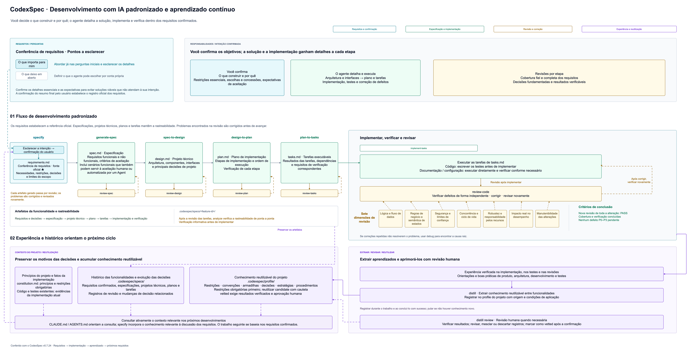

<div align="center">
  <picture>
    <source media="(prefers-color-scheme: dark)" srcset="codexspec-logo-dark.svg">
    <source media="(prefers-color-scheme: light)" srcset="codexspec-logo-light.svg">
    
  </picture>
</div>

<h1 align="center">CodexSpec</h1>

<p align="center">
  <a href="README.md">English</a> | <a href="README.zh-CN.md">中文</a> | <a href="README.ja.md">日本語</a> | <a href="README.es.md">Español</a> | <b>Português</b> | <a href="README.ko.md">한국어</a> | <a href="README.de.md">Deutsch</a> | <a href="README.fr.md">Français</a>
</p>

<p align="center">
  <a href="https://pypi.org/project/codexspec/"></a>
  <a href="https://pypi.org/project/codexspec/"></a>
  <a href="https://opensource.org/licenses/MIT"></a>
</p>

<p align="center">
  <strong>Um conjunto de ferramentas para Requirements-First SDD com Claude Code e OpenAI Codex</strong>
</p>

O CodexSpec transforma requisitos confirmados em especificações, projetos técnicos,
planos, tarefas e implementações com rastreabilidade até suas fontes. Você decide
**o que** construir e **por quê**. O agente define **como** fazer isso dentro dos
requisitos confirmados, com etapas de revisão e conhecimento do projeto mantido
entre sessões.

Use o CodexSpec por meio dos comandos de barra do Claude Code, das skills do Codex
ou de ambos. Por padrão, cada funcionalidade do fluxo comum usa um worktree Git
separado. Um blueprint compartilhado opcional permite que o agente desenvolva
uma fila de requisitos confirmados de forma autônoma.

[📖 Documentação](https://zts0hg.github.io/codexspec/) | [中文文档](https://zts0hg.github.io/codexspec/zh/) | [日本語ドキュメント](https://zts0hg.github.io/codexspec/ja/) | [한국어 문서](https://zts0hg.github.io/codexspec/ko/) | [Documentación](https://zts0hg.github.io/codexspec/es/) | [Documentation](https://zts0hg.github.io/codexspec/fr/) | [Dokumentation](https://zts0hg.github.io/codexspec/de/) | [Documentação](https://zts0hg.github.io/codexspec/pt-BR/)

## Índice

- [Por que escolher o CodexSpec?](#por-que-escolher-o-codexspec)
- [Início rápido em 30 segundos](#início-rápido-em-30-segundos)
- [Instalação](#instalação)
- [Fluxo de trabalho principal](#fluxo-de-trabalho-principal)
- [Blueprint compartilhado e desenvolvimento autônomo](#blueprint-compartilhado-e-desenvolvimento-autônomo)
- [Desenvolvimento com worktrees](#desenvolvimento-com-worktrees)
- [Trabalhar com código existente](#trabalhar-com-código-existente)
- [Revisão e depuração](#revisão-e-depuração)
- [Conhecimento do projeto](#conhecimento-do-projeto)
- [Fluxo de trabalho Git](#fluxo-de-trabalho-git)
- [Comandos disponíveis](#comandos-disponíveis)
- [Configuração e internacionalização](#configuração-e-internacionalização)
- [Estrutura do projeto](#estrutura-do-projeto)
- [Materiais para extensões](#materiais-para-extensões)
- [Desenvolvimento](#desenvolvimento)
- [Contribuições](#contribuições)
- [Licença](#licença)

## Por que escolher o CodexSpec?

| Necessidade | O que o CodexSpec oferece |
|------|-------------------------|
| Clareza sobre a intenção do produto | Confirmação explícita e requisitos salvos em `requirements.md` antes da especificação |
| Desenvolvimento rastreável | Referências às fontes ao longo da sequência requisitos → especificação → projeto técnico → plano → tarefas |
| Decisões que podem ser revisadas | Quatro comandos de revisão de artefatos, análise entre artefatos e uma verificação separada de defeitos no código como critério de aprovação |
| Continuidade entre sessões e no trabalho em equipe | Registros das funcionalidades, princípios do projeto, conhecimento reutilizável e decisões anteriores relevantes |
| Várias funcionalidades em andamento | Um worktree Git por funcionalidade do fluxo comum, com reutilização consistente do espaço de trabalho |
| Mais automação | Avanço opcional entre etapas e desenvolvimento autônomo dos requisitos confirmados do blueprint |
| Preferências de idioma da equipe | Idiomas independentes para interação, documentos e commits |

### O que é Requirements-First SDD?

No desenvolvimento orientado a especificações que prioriza os requisitos
(Requirements-First Spec-Driven Development), os **requisitos confirmados são a
referência de maior prioridade para a funcionalidade**. Antes de derivar os
artefatos de implementação, o agente registra objetivos, restrições, decisões,
exclusões, perguntas em aberto e evidências de confirmação.

```text
Idea → Confirmed Requirements →     Spec    →     Design    →     Plan    →    Tasks     →     Code
                 ↓                   ↓              ↓              ↓             ↓              ↓
         User confirmation      review-spec   review-design   review-plan   review-tasks   review-code
```

Você confirma os requisitos; cada artefato derivado passa por uma revisão própria,
da especificação ao código.

A colaboração com as pessoas define e altera a intenção do produto. As revisões
automáticas verificam se os artefatos derivados correspondem a essa intenção.
Quando ativada, a automação faz o trabalho avançar pelas etapas aprovadas. Ela
não permite que o agente substitua silenciosamente os requisitos confirmados.

<!-- workflow-diagram:start -->
<picture>
  <source media="(prefers-color-scheme: dark)" srcset="assets/workflow/workflow-pt-BR-dark.png">
  
</picture>

Ver em tamanho original: [☀️](assets/workflow/workflow-pt-BR-light.png) · [🌙](assets/workflow/workflow-pt-BR-dark.png)
<!-- workflow-diagram:end -->

## Início rápido em 30 segundos

Instale o CodexSpec e inicialize o projeto para o assistente que você usa:

```bash
uv tool install codexspec

# Create a new project for Claude Code
codexspec init my-project --ai claude

# Or initialize an existing project for Codex
cd your-existing-project
codexspec init . --ai codex

# Use --ai both when you want both integrations
```

Inicie o assistente instalado no projeto inicializado. O mesmo fluxo de trabalho
pode ser iniciado das seguintes formas:

| Assistente | Iniciar a descoberta de requisitos |
|-----------|------------------------------|
| Claude Code (`claude`) | `/codexspec:specify I want to build a todo application` |
| Codex (`codex`) | `$codexspec:specify I want to build a todo application` |

Personalize os princípios do projeto com `constitution` quando necessário.
Confirme o resumo final dos requisitos e continue no diretório da funcionalidade
e no espaço de trabalho retornados. Consulte o [Fluxo de trabalho principal](#fluxo-de-trabalho-principal)
para conhecer os comandos seguintes.

Se você usa o aplicativo desktop do Codex, pode [pedir ao Codex para instalar e inicializar seu projeto](#instalação-pelo-aplicativo-desktop-do-codex).

## Instalação

### Instalação pelo aplicativo desktop do Codex

Você pode pedir ao Codex para instalar o CodexSpec e configurar seu projeto
diretamente pelo aplicativo desktop.

1. Adicione um projeto local no aplicativo desktop do Codex e selecione a pasta em que deseja trabalhar.
2. Inicie uma conversa nesse projeto e cole a solicitação abaixo.
3. Se o aplicativo pedir permissão para baixar ou instalar dependências, aprove a ação solicitada para continuar.

```text
Please install and initialize CodexSpec in the current project.
Project: https://github.com/Zts0hg/codexspec

Complete the setup directly instead of asking me to run terminal commands.

Check the environment. If uv or Python 3.11+ is missing, install the required
tools in my user directory using their official installation instructions.
Install the latest stable release of CodexSpec.

For a new setup, initialize the current project for Codex in English:
codexspec init . --ai codex --lang en

If CodexSpec is already configured, check its version and configuration before
updating. Preserve existing requirements, project principles, user files,
and configuration settings.

Verify that the CLI works and that AGENTS.md and the CodexSpec skill files
under .agents/skills/ are installed. Explain the result and how to start
describing my requirements in plain English. If the skills are not yet
available in this chat, tell me whether to start a new chat or restart the app.
```

Para respostas e documentos em chinês, substitua `--lang en` por `--lang zh-CN`
e peça ao Codex para explicar o resultado em chinês.

O Codex instala a mesma CLI e as mesmas skills de projeto usadas na configuração
manual abaixo. Depois, você pode começar com uma solicitação como
`$codexspec:specify I want to build a todo application`. O [guia de skills da OpenAI](https://learn.chatgpt.com/docs/build-skills)
explica como as skills locais são descobertas e atualizadas.

### Pré-requisitos

- Python 3.11+
- [uv](https://docs.astral.sh/uv/) (recomendado) ou pip
- O assistente que você pretende usar: Claude Code ou Codex
- Git para o desenvolvimento com worktrees e os fluxos de trabalho Git

### Instalação da CLI

```bash
uv tool install codexspec

# Or use pip
pip install codexspec

# Verify the CLI and inspect available commands
codexspec version
codexspec --help
codexspec list-commands
```

Inicialize um novo projeto com `codexspec init my-project --ai claude` ou o
diretório atual com `codexspec init . --ai codex`. Use `--ai both` para as duas
integrações. O assistente padrão é `claude`; para usar Codex ou ambos, informe
essa escolha explicitamente.

<details>
<summary>Métodos alternativos de instalação</summary>

#### Inicialização em uma única execução

```bash
uvx codexspec init my-project --ai claude
uvx codexspec init . --ai codex
```

A inicialização em uma única execução instala os comandos do projeto e o ambiente
independente de execução de commits. O roteamento de worktrees, blueprint/auto-dev
e a revisão manual do perfil continuam usando a CLI do CodexSpec. Deixe essa CLI
disponível para esses fluxos de trabalho.

#### Versões de desenvolvimento

```bash
uv tool install git+https://github.com/Zts0hg/codexspec.git
uv tool install git+https://github.com/Zts0hg/codexspec.git@main

# Replace <tag> with the version you want
uv tool install git+https://github.com/Zts0hg/codexspec.git@<tag>
```

</details>

<details>
<summary>Instalação no Windows</summary>

Use o PowerShell:

```powershell
powershell -c "irm https://astral.sh/uv/install.ps1 | iex"
# Restart PowerShell, then:
uv tool install codexspec
codexspec version
```

Consulte o [Guia de solução de problemas no Windows](docs/en/WINDOWS-TROUBLESHOOTING.md)
para resolver problemas com PATH e instalação.

</details>

### Atualizar a CLI e os comandos de um projeto

Atualizar a CLI e atualizar os comandos instalados em um projeto são duas etapas distintas:

```bash
uv tool install codexspec --upgrade
# Or: pip install --upgrade codexspec

# In the project you want to refresh; select its desired integration(s)
codexspec init . --force --ai both
```

Use `--ai claude` ou `--ai codex` se quiser apenas essa integração. `--force`
regenera os comandos e scripts distribuídos e atualiza os recursos de revisão.
Também confirma automaticamente as solicitações de migração, atualização de
comandos e conformidade com a Constituição do Projeto. Os requisitos e princípios
existentes são mantidos. Nos arquivos de contexto existentes, as orientações
gerenciadas são atualizadas e o restante do conteúdo é preservado. As chaves de
configuração que você não definir explicitamente também são mantidas.

O comando de planejamento é `design-to-plan`. As atualizações da instalação
removem a entrada antiga `spec-to-plan`, sem manter um alias.

### Instalação pelo marketplace de plugins

Para Claude Code, instale o plugin pelo marketplace:

```text
/plugin marketplace add Zts0hg/codexspec
/plugin install codexspec@codexspec-market
/codexspec:config
```

O plugin fornece comandos e orientações no início da sessão para a análise das
alterações na área de preparação e a consulta aos requisitos anteriores,
inclusive em sessões retomadas. A instalação do plugin não inicializa um projeto.
Use `/codexspec:config` para criar ou alterar configurações de idioma, fluxo de
trabalho e revisão. Quando precisar da estrutura completa do projeto, use a
inicialização pela CLI.

A prévia direta de commits e os commits autorizados no diretório de trabalho
atual podem usar o ambiente de execução incluído, com Python 3.11+ e Git, sem uma
CLI do CodexSpec instalada de forma permanente. O roteamento de worktrees,
blueprint/auto-dev e a revisão manual do perfil continuam exigindo a CLI. O hook
de inicialização do plugin requer Git no PATH e uma versão do Claude Code que
aceite `args` em hooks de comando (forma exec). As orientações são destinadas
ao agente; o hook não intercepta comandos Git executados manualmente.

Consulte [Instalação](docs/en/getting-started/installation.md) para ver os detalhes da configuração.

## Fluxo de trabalho principal

O fluxo de trabalho padrão de uma funcionalidade mantém uma sequência de
artefatos ligados por referências às fontes:

```text
/specify          → requirements.md
/generate-spec    → spec.md       → review-spec
/spec-to-design   → design.md     → review-design
/design-to-plan   → plan.md       → review-plan
/plan-to-tasks    → tasks.md      → review-tasks → analyze
/implement-tasks  → implementation and complete-feature code review
```

Os exemplos abaixo usam o prefixo `/codexspec:` do Claude. No Codex, use
`$codexspec:` com o mesmo nome de comando e os mesmos argumentos.

| Etapa | Comando | Finalidade e resultado |
|------|---------|--------------------|
| Princípios do projeto | `/codexspec:constitution` | Criar ou atualizar `constitution.md` e validar os artefatos afetados |
| Requisitos | `/codexspec:specify <idea>` | Discutir a intenção, confirmar o resumo final e salvar `requirements.md` |
| Especificação | `/codexspec:generate-spec <feature-dir>` | Transformar os requisitos confirmados em `spec.md`, com referências às fontes |
| Projeto técnico do sistema | `/codexspec:spec-to-design <feature-dir>` | Produzir `design.md` com componentes, interfaces e decisões importantes de projeto técnico |
| Plano de implementação | `/codexspec:design-to-plan <feature-dir>` | Produzir `plan.md` com fases, ordem e verificação |
| Tarefas | `/codexspec:plan-to-tasks <feature-dir>` | Produzir tarefas rastreáveis e verificáveis em `tasks.md` e executar a análise entre artefatos |
| Implementação | `/codexspec:implement-tasks <feature-dir>` | Executar as tarefas, verificar os resultados e corrigir os achados da revisão confirmados de forma independente |

Substitua `<feature-dir>` pelo diretório da funcionalidade retornado durante a
descoberta de requisitos. Continue no worktree correspondente ou informe seu
caminho explícito. Assim, os comandos e as sessões continuam trabalhando com a
mesma funcionalidade.

### specify, clarify e analyze

- **specify** inicia ou retoma a descoberta de requisitos. O resumo dos requisitos
  só se torna vinculante após confirmação explícita.
- **clarify** resolve ambiguidades nos requisitos e na especificação existentes,
  com até cinco perguntas por execução, distribuídas em quatro categorias.
  Primeiro atualiza `requirements.md` e depois sincroniza `spec.md`.
- **analyze** verifica toda a sequência requisitos → especificação → projeto
  técnico → plano → tarefas. Aplica automaticamente correções determinísticas aos
  artefatos posteriores quando a correção decorre das fontes anteriores que os
  regem. Nunca edita `requirements.md`. Os achados não resolvidos são relatados.
  A análise é executada automaticamente após uma revisão de tarefas aprovada e
  tem caráter informativo; ela não é um critério de aprovação da implementação.

```text
/codexspec:clarify <feature-dir>
/codexspec:analyze <feature-dir>
```

### Pequenas alterações com Quick

Use `quick` para uma alteração pequena e bem delimitada, como uma correção pontual:

```text
/codexspec:quick Fix the empty-state message on the task list
```

O Quick confirma e salva um resumo compacto dos requisitos. Em seguida, coordena
a especificação, o planejamento, as tarefas e a implementação, incluindo as
revisões dos comandos de geração. Alterações amplas ou decisões de produto e
projeto técnico ainda em aberto exigem o fluxo de trabalho padrão. O Quick pausa
quando precisa de uma nova decisão.

### Automação do fluxo de trabalho

O padrão de `workflow.auto_next` é **false**. Se estiver definido como `true` na
configuração do espaço de trabalho ativo, a confirmação final dos requisitos dá
início à especificação. Cada etapa de geração avança após `PASS` ou
`PASS_WITH_WARNINGS`. `NEEDS_REVISION` ou `BLOCKED` interrompe a sequência, que
termina em `implement-tasks`.

A correção automática de artefatos se limita a defeitos verificados cuja solução
decorre de evidências dos artefatos anteriores. São permitidas no máximo duas
rodadas de correção e revisão. As recomendações são tratadas separadamente.
O ciclo de revisão e correção da implementação tem regras próprias de conclusão,
descritas abaixo.

Consulte o [guia do fluxo de trabalho](docs/en/user-guide/workflow.md) para ver as regras detalhadas.

## Blueprint compartilhado e desenvolvimento autônomo

Use `blueprint` para preparar vários requisitos confirmados antes do
desenvolvimento e `auto-dev` para desenvolver essa fila:

```text
/codexspec:blueprint Add a confirmed requirement for task reminders
/codexspec:auto-dev
```

Na descoberta de requisitos para o blueprint, são definidas a direção, as escolhas
e as restrições que cabem ao usuário, antes que um requisito entre na fila.
O arquivo compartilhado `.codexspec/blueprint.md` usa os estados `pending`,
`in_progress` e `completed`. Você pode acrescentar, substituir, excluir ou
reordenar requisitos pendentes. Entradas ativas e concluídas não podem ser
alteradas pela manutenção do blueprint.

O Auto-dev segue a ordem do documento. Retoma a funcionalidade em andamento antes
de iniciar outra e relê a fila após cada conclusão. Assim, novos requisitos
pendentes acrescentados à fila podem ser incluídos na execução. Ele realiza as
etapas de SDD, implementação, verificação, revisão e correção dentro dos requisitos
confirmados. Chamar `auto-dev` ativa essa automação independentemente de
`workflow.auto_next`, sem alterar essa configuração.

Os dois comandos usam `worktree-for-codexspec-auto-dev` no branch
`codexspec/auto-dev`. Eles podem operar simultaneamente, respeitando as proteções
compartilhadas de controle do espaço de trabalho e de escrita. Nesse espaço, os
requisitos são desenvolvidos em sequência. Quando uma decisão de produto não pode
ser resolvida com base nos requisitos confirmados, a execução é interrompida e
as evidências são apresentadas. Durante a execução autônoma normal, não são
feitas perguntas para resolver essas decisões.

Veja o blueprint compartilhado atual sem alterá-lo:

```bash
codexspec show-blueprint
```

## Desenvolvimento com worktrees

Um worktree Git é outro diretório de trabalho do mesmo repositório, com seu próprio
branch selecionado. Por padrão, o CodexSpec usa um worktree por funcionalidade do
fluxo comum. Ele é criado antes de salvar os primeiros requisitos e reúne os
documentos, a implementação, os testes e as correções da funcionalidade.

```text
projects/
├── my-project/
└── my-project-codexspec-worktrees/
    ├── <feature-id>-task-reminders/
    ├── <feature-id>-search/
    ├── worktree-for-codexspec-maintenance/
    └── worktree-for-codexspec-auto-dev/
```

Ao retomar uma funcionalidade, seu espaço de trabalho é reutilizado. Alterações
independentes de configuração, Constituição do Projeto e perfil usam o worktree
de manutenção. Alterações feitas durante uma funcionalidade ativa permanecem no
worktree dela. A configuração é **local a cada checkout**: uma configuração
alterada em um worktree escolhido pelo roteamento entra em vigor primeiro ali
e chega aos outros checkouts pela integração Git. Execute os comandos da CLI e
as verificações no espaço de trabalho retornado.

Para definir a base de uma nova funcionalidade, o histórico já registrado em
commits do branch principal local é comparado ao histórico do branch principal
remoto obtido por fetch, usando a ancestralidade Git. Históricos divergentes são
mesclados no novo worktree e exigem verificação. Se o fetch falhar, um aviso é
emitido e as referências disponíveis localmente podem ser usadas. Se a criação
falhar, o sistema não passa a gravar no checkout principal como alternativa.

O padrão de `workflow.worktrees` é **true**. Somente o valor YAML literal `false`
desativa o isolamento das funcionalidades do fluxo comum e da manutenção.
Blueprint/auto-dev mantêm seu worktree compartilhado fixo em ambos os casos.
A inicialização e as atualizações da instalação ocorrem no checkout selecionado
explicitamente. Worktrees concluídos são mantidos; a conclusão não os mescla
nem os exclui automaticamente.

Consulte [Desenvolvimento com worktrees](docs/en/user-guide/workflow.md#worktree-development)
e [configuração](docs/en/reference/configuration.md#workflowworktrees).

## Trabalhar com código existente

Há dois pontos de entrada para objetivos diferentes:

| Comando | Use para | Resultado e limites |
|---------|-----------|-----------------|
| `onboard [path]` | Formar o conhecimento reutilizável do projeto a partir de uma base de código existente | Convenções candidatas e restrições de escopo delimitado e fundamentadas em evidências no perfil; o código permanece somente leitura |
| `reverse-spec [path]` | Entender a arquitetura existente ou comparar o código com a intenção confirmada | Artefatos em rascunho ou relatório de divergências; o código permanece somente leitura |

```text
/codexspec:onboard src/
/codexspec:reverse-spec
/codexspec:reverse-spec src/auth
```

O Onboard infere convenções a partir do código observável e só propõe restrições
com base em proibições explícitas. Convenções candidatas têm efeito local imediato.
Restrições candidatas exigem uma decisão na sessão: salvar, editar ou descartar.
O conhecimento existente é preservado. Uma análise inicial não serve para inventar
justificativas de decisões anteriores nem relatos de armadilhas vivenciadas.

O Reverse-spec tem três modos:

- **Visão geral**: sem um caminho, ou com a raiz do repositório, produz um projeto
  de arquitetura conciso em `design.md`, além de `slices.md` para escolher os
  módulos que serão examinados.
- **Geração**: um caminho de módulo sem uma base confirmada produz rascunhos de
  `spec.md`, `design.md` e requisitos em aberto ou inferidos.
- **Reconciliação**: um módulo com uma base confirmada produz `reconcile.md`,
  que relata comportamentos não documentados, especificações não implementadas
  e diferenças semânticas em relação à especificação e ao projeto técnico
  confirmados. Os requisitos determinam a intenção.

Rascunhos inferidos precisam de confirmação humana antes de servirem como base.
A reconciliação indica a direção proposta: corrigir o código, atualizar os
documentos ou decidir a intenção. Ela não aplica essa proposta automaticamente.

## Revisão e depuração

Quatro revisores de artefatos verificam fidelidade, cobertura, viabilidade e
qualidade interna: `review-spec`, `review-design`, `review-plan` e `review-tasks`.
Eles são executados automaticamente após a geração e também podem ser chamados
manualmente. Os relatórios distinguem defeitos verificados de recomendações de
risco que não bloqueiam a aprovação e de oportunidades de melhoria no projeto
técnico. Também incluem uma pontuação de compatibilidade.

O `review-code` oferece uma verificação separada de defeitos nas alterações
selecionadas como critério de aprovação (gate de defeitos), além de uma avaliação
explícita da qualidade de todo o código:

```text
/codexspec:review-code --feature <feature-dir>
/codexspec:review-code --uncommitted
/codexspec:review-code --audit src/
```

Por padrão, a revisão abrange todas as diferenças do branch da funcionalidade:
alterações com commit, na área de preparação, fora da área de preparação e não
rastreadas que não estejam ignoradas. Você pode selecionar explicitamente
alterações com commit, sem commit ou de um único commit como evidência.
`--feature` acrescenta o contexto dos requisitos sem reduzir o escopo Git.
`--audit` avalia os caminhos indicados e produz uma avaliação consultiva, em vez
de um veredito de conclusão.

As revisões carregam padrões compartilhados de `.codexspec/review-code/` e
selecionam as dimensões de comportamento relevantes, além das verificações de
linguagem e framework. Os achados precisam de evidências concretas, condições que
possam ocorrer, atribuição à alteração selecionada e impacto demonstrado.
O revisor relata defeitos e sugestões de manutenção fundamentadas sem editar
arquivos. Quem conduz a correção verifica esses achados de forma independente.

Nas tarefas de código, os testes são escritos primeiro. Tarefas de documentação
e configuração são implementadas diretamente, com as verificações adequadas.
Após as correções, a revisão incremental pode reutilizar a cobertura de revisão
das partes não afetadas. A aceitação final exige um novo `PASS` para a
funcionalidade completa, cobertura e verificação concluídas e nenhum defeito
P0–P3 admitido. As sugestões de manutenção fundamentadas são relatadas separadamente.

O padrão de `workflow.auto_maintenance` é **true**. Essa configuração controla se
quem conduz as correções também aplica melhorias de manutenção verificadas e
compatíveis. Quando ela é desativada, as sugestões continuam sendo relatadas;
os defeitos ainda precisam ser corrigidos e as verificações obrigatórias
continuam sendo exigidas. A configuração é independente do avanço entre etapas
e não é um argumento de `implement-tasks`.

Para uma depuração que começa pela investigação da causa raiz:

```text
/codexspec:debug Investigate intermittent failures when saving a task
```

O Debug segue a sequência investigação → análise de padrões → verificação de
uma única hipótese → correção precedida de um teste que falha. Durante a
implementação, essa investigação é acionada quando as correções não avançam,
um defeito não trivial no comportamento do código precisa ser rastreado
ou a mesma classe de causa raiz reaparece em várias rodadas de revisão.
Após três correções malsucedidas, a arquitetura é reavaliada.

Use `checklist` para avaliar a clareza, a completude e a consistência dos requisitos:

```text
/codexspec:checklist Check the authentication requirements for completeness
```

A [referência de comandos](docs/en/user-guide/commands.md) detalha as opções de
seleção da revisão, os argumentos e os procedimentos.

## Conhecimento do projeto

O perfil do projeto armazena conhecimento reutilizável em `.codexspec/profile/`:

| Categoria | Conteúdo |
|----------|----------|
| `constraints/` | Proibições explícitas e limites rígidos; devem ser lidos primeiro |
| `conventions/` | Padrões, nomenclatura e orientações que se aplicam a várias funcionalidades |
| `pitfalls/` | Armadilhas vivenciadas, causas, soluções alternativas e lições |
| `decisions/` | Decisões reutilizáveis de arquitetura e de assuntos comuns a várias funcionalidades |
| `strategies/` | Sinais de que é preciso mudar a abordagem de trabalho |
| `runbooks/` | Procedimentos ordenados e recuperação de falhas |

O `distill` captura conhecimento reutilizável do trabalho. A intenção específica
de cada funcionalidade permanece nos requisitos, no projeto técnico e no plano
dela. O Init instala orientações em CLAUDE.md e/ou AGENTS.md para ler todas as
restrições e o conhecimento relevante antes de realizar trabalho substancial. Conhecimento acrescentado depois pode ter efeito sem uma nova
inicialização. Registros candidatos são usados com cautela. Registros validados
exigem a verificação dos resultados e a aprovação de uma pessoa.

```text
/codexspec:distill Capture the reusable lessons from this work
/codexspec:distill review
/codexspec:evolve
```

Um `distill review` manual, ou um `distill` direto sem novo material para capturar,
abre um espaço de trabalho local e offline no navegador. Nele, você pode revisar,
validar, descartar, adiar e consolidar registros, conferir uma prévia do Markdown
final e selecionar **Aplicar tudo**. Até a aplicação, as decisões ficam em um
rascunho recuperável. As verificações de conflito impedem a aplicação parcial e
a sobrescrita silenciosa. Há uma alternativa explícita em texto para ambientes
sem navegador.

O padrão de `workflow.auto_distill` é **true** e controla três hooks de encerramento:
`implement-tasks` concluído com sucesso, commits executados por `commit-staged`
e geração por `pr`. A prévia de um commit não aciona a captura.

As orientações instaladas no projeto também pedem aos agentes que capturem
conhecimento reutilizável assim que ele surgir: em conversas comuns, em correções
fora de SDD e durante execuções longas de `implement-tasks`. Essas orientações
valem independentemente da configuração de encerramento. A captura ao final da
tarefa funciona como uma última salvaguarda.

Na mesma sessão, acionamentos repetidos processam apenas material novo. Entre
sessões, o `distill` lê o perfil e ignora conhecimento já registrado. Se não
restar nada reutilizável, a captura termina sem gravar. A captura automática nunca abre a revisão manual, não espera por uma pessoa
nem bloqueia o fluxo de trabalho que a chamou.

O `evolve` seleciona apenas conhecimento validado que seja útil além do projeto
e o transforma em um rascunho de comando ou skill. Antes de fazer push ou abrir
um PR de contribuição para revisão humana, obtém aprovação explícita.

Veja mais orientações em [Conhecimento do projeto](docs/en/user-guide/commands.md#codexspecdistill).

### Reutilizar decisões anteriores

Antes de fazer perguntas sobre uma mudança, o agente consulta o histórico das
funcionalidades relacionadas em `.codexspec/specs/`. Ele lê as decisões confirmadas
em `requirements.md`, acompanha os acréscimos posteriores e as substituições
explícitas e, quando necessário, consulta as justificativas do projeto técnico
ou as evidências da implementação. Essa preparação também deve preceder análises
e decisões relevantes sobre projeto técnico, implementação, depuração ou revisão,
tanto em conversas comuns quanto nos fluxos de trabalho SDD.

Os registros de data e hora dos diretórios de funcionalidades ajudam a reconstruir
a ordem das iterações; um documento mais recente não invalida automaticamente uma
decisão anterior. Requisitos anteriores que não foram alterados continuam válidos,
e propostas em aberto não são tratadas como intenção confirmada. A consulta se
concentra na tarefa atual e termina quando há contexto suficiente, que será
reaproveitado nas etapas seguintes.

Por exemplo, ao alterar uma interface, um agente que não consultou o histórico
poderia perguntar:

> “Como esta funcionalidade deve lidar com a compatibilidade com versões anteriores?”

Depois de verificar as decisões relevantes e a implementação atual, ele pode
fazer uma pergunta mais específica:

> “Você havia confirmado que a interface antiga deveria ser mantida, e a
> implementação atual ainda oferece suporte a ela. Sugiro mantê-la nesta mudança.
> Podemos seguir assim?”

Informações já estabelecidas que claramente continuam válidas podem ser
reutilizadas sem repetir a pergunta. Se você já disse “Remova a interface antiga
nesta mudança”, o agente segue essa decisão e explica os impactos da migração.
**Sua decisão explícita mais recente sempre prevalece**; o histórico ajuda a
preparar perguntas mais precisas e evitar repetições.

Atualize as instalações existentes dos projetos para receber essas orientações.

## Fluxo de trabalho Git

```text
/codexspec:commit-staged -p
/codexspec:pr --spec <feature-dir>/spec.md
/codexspec:release-notes --from <ref> --to HEAD
/codexspec:tasks-to-issues <feature-dir>
```

- **commit-staged** analisa exatamente a área de preparação e gera uma mensagem
  no padrão Conventional Commits. `-p` mostra uma prévia sem criar um commit.
  O fluxo de trabalho que chama o comando escolhe os arquivos e os adiciona à
  área de preparação. A execução autorizada usa o ambiente de execução protegido
  e confere novamente se o conteúdo incluído no commit corresponde à análise.
  As orientações de commit para agentes se aplicam a conversas comuns e aos
  fluxos SDD, blueprint e auto-dev. A simples disponibilidade do comando não
  significa que ele foi chamado nem autoriza um commit.
- **pr** gera uma descrição estruturada de PR do GitHub ou MR do GitLab a partir
  das diferenças. `--spec` pode acrescentar o contexto da funcionalidade: aceita
  o caminho de um arquivo `spec.md`, ou o nome ou prefixo de um diretório de
  funcionalidade que seja resolvido para esse arquivo. Por padrão, a saída é
  texto para uso na plataforma de hospedagem.
- **release-notes** gera, a partir do histórico Git, uma entrada no formato Keep
  a Changelog e um texto de lançamento. A seção padrão é `[Unreleased]`;
  `--version` usa o rótulo informado. O comando não adiciona arquivos à área de preparação, não cria commits,
  não incrementa versões, não cria tags, não publica e não cria lançamentos.
- **tasks-to-issues** cria issues do GitHub a partir de tarefas existentes,
  incluindo dependências e critérios de aceitação. Requer uma CLI do GitHub
  autenticada e verifica se o repositório das issues corresponde ao remoto configurado.

A prévia direta de commits e os commits autorizados no diretório de trabalho
atual exigem Python 3.11+ e Git. O ambiente de execução é instalado nos projetos
inicializados pela CLI e incluído no plugin do Claude. Mesclagens com alterações
de conteúdo criadas pelo agente também usam a análise da área de preparação.
Mesclagens que apenas unem históricos mantêm a mensagem padrão do Git, mas
validam a árvore e os commits pais. Fast-forwards não criam commit.

## Comandos disponíveis

A CLI tem seis comandos públicos. As integrações de agentes distribuem 28
comandos: Claude usa `/codexspec:<name>` e Codex usa `$codexspec:<name>`.
As tabelas abaixo usam a forma do Claude para facilitar a leitura.

### Comandos da CLI

| Comando | Finalidade |
|---------|---------|
| `codexspec init` | Inicializar ou atualizar um projeto para Claude, Codex ou ambos |
| `codexspec check` | Verificar ferramentas e dependências instaladas |
| `codexspec version` | Exibir informações de versão e sistema |
| `codexspec config` | Consultar ou alterar a configuração do projeto |
| `codexspec list-commands` | Listar os comandos de agentes disponíveis por categoria |
| `codexspec show-blueprint` | Exibir o blueprint do worktree compartilhado sem alterá-lo |

### Comandos do fluxo de trabalho principal

| Comando | Finalidade |
|---------|---------|
| `/codexspec:constitution` | Criar ou atualizar os princípios do projeto com validação entre artefatos |
| `/codexspec:specify` | Discutir, confirmar e salvar os requisitos da funcionalidade |
| `/codexspec:blueprint` | Preparar ou manter requisitos confirmados e pendentes do blueprint |
| `/codexspec:generate-spec` | Transformar requisitos confirmados em uma especificação rastreável; revisão automática |
| `/codexspec:spec-to-design` | Definir arquitetura, componentes, interfaces e decisões; revisão automática |
| `/codexspec:design-to-plan` | Planejar as fases, a ordem e a verificação da implementação; revisão automática |
| `/codexspec:plan-to-tasks` | Produzir tarefas verificáveis que cubram os artefatos anteriores; revisão automática e analyze |
| `/codexspec:implement-tasks` | Executar tarefas, verificar resultados, revisar e corrigir |
| `/codexspec:auto-dev` | Desenvolver autonomamente os requisitos confirmados do blueprint, na ordem do documento |

### Comandos de revisão de artefatos

| Comando | Finalidade |
|---------|---------|
| `/codexspec:review-spec` | Verificar a fidelidade e a qualidade interna da especificação |
| `/codexspec:review-design` | Verificar a fidelidade, a viabilidade e se o projeto técnico está pronto para o planejamento |
| `/codexspec:review-plan` | Verificar a fidelidade, a viabilidade e se o plano está pronto para a implementação |
| `/codexspec:review-tasks` | Verificar a fidelidade, as dependências, a possibilidade de execução e a verificação das tarefas |

### Requisitos, código existente e depuração

| Comando | Finalidade |
|---------|---------|
| `/codexspec:clarify` | Resolver ambiguidades nos requisitos; atualizá-los antes da especificação |
| `/codexspec:analyze` | Verificar a rastreabilidade de ponta a ponta e adequar os artefatos posteriores às fontes que os regem |
| `/codexspec:checklist` | Gerar uma lista de verificação da qualidade dos requisitos |
| `/codexspec:tasks-to-issues` | Converter tarefas existentes em issues do GitHub que orientem sua execução |
| `/codexspec:debug` | Investigar as causas raiz antes de aplicar uma correção |
| `/codexspec:reverse-spec` | Examinar a arquitetura existente, criar rascunhos de artefatos de módulos ou relatar divergências em relação à base |

### Comandos de conhecimento do projeto

| Comando | Finalidade |
|---------|---------|
| `/codexspec:distill` | Capturar conhecimento reutilizável ou revisar registros candidatos no espaço de trabalho local |
| `/codexspec:evolve` | Transformar conhecimento validado em um rascunho de contribuição upstream |
| `/codexspec:onboard` | Extrair do código existente convenções candidatas e restrições fundamentadas |

### Comandos de Git e revisão de código

| Comando | Finalidade |
|---------|---------|
| `/codexspec:commit-staged` | Gerar mensagens a partir das alterações na área de preparação; mostrar uma prévia ou executar um commit autorizado |
| `/codexspec:pr` | Gerar uma descrição estruturada de PR/MR |
| `/codexspec:release-notes` | Manter uma entrada no changelog e gerar um texto de lançamento a partir do histórico Git |
| `/codexspec:review-code` | Revisar as alterações selecionadas como gate de defeitos; usar `--audit` para avaliar a qualidade do código nos caminhos indicados |

### Comandos utilitários

| Comando | Finalidade |
|---------|---------|
| `/codexspec:config` | Criar, consultar, alterar ou redefinir a configuração do projeto de forma interativa |
| `/codexspec:quick` | Executar um fluxo compacto de Requirements-First SDD para pequenas alterações |

## Configuração e internacionalização

A configuração fica em `.codexspec/config.yml`. Os modelos continuam em inglês;
os agentes escrevem as interações e os artefatos gerados nos idiomas configurados.
Os 13 códigos de idioma padrão são `en`, `zh-CN`, `zh-TW`, `ja`, `ko`, `es`,
`fr`, `de`, `pt`, `ru`, `it`, `ar` e `hi`.
O código da CLI para português é `pt`; a documentação localizada e os catálogos
de tradução usam `pt-BR`.

### Dimensões de idioma

| Dimensão | Chave de configuração | Na inicialização | Definir depois | Controla |
|-----------|------------|-------------------|-----------|----------|
| Saída/base | `language.output` | `--lang` | `config --set-lang` | Idioma usado quando as demais dimensões não têm configuração própria |
| Interação | `language.interaction` | `--interaction-lang` | `config --set-interaction-lang` | Conversas e saída da CLI |
| Documento | `language.document` | `--document-lang` | `config --set-document-lang` | Requisitos, especificações, projetos técnicos, planos e tarefas |
| Commit | `language.commit` | `--commit-lang` | `config --set-commit-lang` | Mensagens de commit e textos gerados nos fluxos de trabalho com Git |

Quando uma dimensão não tem um idioma próprio configurado, ela usa
`language.output`, independentemente das outras dimensões. Se esse valor também
não estiver definido, usa `en`. `language.templates` continua sendo `en`.

```bash
codexspec init my-project --ai both \
  --interaction-lang zh-CN --document-lang en --commit-lang en

codexspec config
codexspec config --set-document-lang en
codexspec config --list-langs
```

Na primeira inicialização com TTY, o idioma base é solicitado, a menos que você
informe `--lang` ou as três opções específicas de idioma. `--force` confirma
automaticamente as outras solicitações de inicialização, mas não elimina essa
escolha de idioma. Sem TTY, o padrão é inglês. Ao inicializar novamente, as chaves
de idioma que você não definir explicitamente são preservadas.

### Configurações de fluxo de trabalho e revisão

| Configuração | Padrão | Efeito | Controle pela CLI |
|---------|---------|--------|-------------|
| `workflow.auto_next` | `false` | Avançar pelas etapas aprovadas do fluxo comum de SDD | `config --auto-next on\|off` |
| `workflow.auto_distill` | `true` | Capturar conhecimento sem interação após um encerramento bem-sucedido | `config --auto-distill on\|off` |
| `workflow.auto_maintenance` | `true` | Aplicar manutenção incremental verificada durante correções automáticas | `config --auto-maintenance on\|off` |
| `workflow.worktrees` | `true` | Isolar as funcionalidades do fluxo comum e a manutenção independente | `config --worktrees on\|off` |
| `review.decided_by` | `reviewer` | Definir quem decide sobre achados com condições de ocorrência fora do contexto operacional do projeto | `config --decided-by reviewer\|ask` |

As opções booleanas da CLI aceitam `on/true/1/yes` e `off/false/0/no`, sem distinguir
maiúsculas de minúsculas e permitindo espaços em branco ao redor. Uma opção
booleana sem valor alterna o valor atual do checkout de destino. Os valores
armazenados em YAML são booleanos.

Com `review.decided_by: reviewer`, o revisor decide quais achados são admitidos
como defeitos. Com `ask`, uma condição de ocorrência fora do contexto gera uma
decisão de cenário pendente. O usuário decide uma vez se o defeito deve ser
corrigido ou se o cenário deve ser excluído; a decisão confirmada é mantida para
as rodadas seguintes. Decisões pendentes bloqueiam a conclusão. Uma execução
individual de `review-code` pode substituir o modo configurado com `--decided-by`.

As alterações de configuração seguem o roteamento de worktrees. Uma alteração
independente iniciada no checkout principal é feita no worktree de manutenção
e não muda imediatamente a configuração efetiva do checkout principal.
Alterações em um worktree de funcionalidade entram em vigor ali.

<details>
<summary>Opções de inicialização da CLI</summary>

| Opção | Significado |
|--------|---------|
| `PROJECT_NAME` | Nome do novo diretório; use `.` para o diretório atual |
| `--here`, `-h` | Inicializar o diretório atual |
| `--ai`, `-a` | `claude`, `codex` ou `both`; o padrão é `claude` |
| `--lang`, `-l` | Definir o idioma base da saída |
| `--interaction-lang` | Definir o idioma de interação |
| `--document-lang` | Definir o idioma dos documentos |
| `--commit-lang` | Definir o idioma das mensagens de commit |
| `--force`, `-f` | Regenerar os artefatos instalados e confirmar automaticamente solicitações de migração, atualização e conformidade; preservar o contexto escrito para o projeto e as configurações não relacionadas |
| `--no-git` | Pular a inicialização do repositório Git |
| `--debug`, `-d` | Exibir informações detalhadas de depuração |

</details>

<details>
<summary>Opções de configuração da CLI</summary>

| Opção | Significado |
|--------|---------|
| `--set-lang`, `-l` | Definir o idioma base da saída |
| `--set-interaction-lang` | Definir o idioma de interação |
| `--set-document-lang` | Definir o idioma dos documentos |
| `--set-commit-lang`, `-c` | Definir o idioma das mensagens de commit |
| `--list-langs` | Listar os códigos de idioma aceitos |
| `--auto-next` | Alternar ou definir o avanço automático entre etapas |
| `--auto-distill` | Alternar ou definir a captura automática de conhecimento |
| `--auto-maintenance` | Alternar ou definir a manutenção incremental automática |
| `--worktrees` | Alternar ou definir o isolamento por worktree local a cada checkout |
| `--decided-by` | Definir o modo de decisão da revisão como `reviewer` ou `ask` |

</details>

<details>
<summary>Exemplo de configuração</summary>

```yaml
version: "1.0"

language:
  output: "en"
  interaction: "zh-CN"
  document: "en"
  commit: "en"
  templates: "en"

project:
  ai: "both"

workflow:
  auto_next: false
  auto_distill: true
  auto_maintenance: true
  worktrees: true

review:
  decided_by: reviewer
```

</details>

Veja os detalhes sobre idiomas e configurações em
[Configuração](docs/en/reference/configuration.md) e
[Internacionalização](docs/en/user-guide/i18n.md).

## Estrutura do projeto

A inicialização instala os recursos comuns e a integração do assistente selecionado:

```text
my-project/
├── .codexspec/
│   ├── config.yml
│   ├── memory/
│   │   └── constitution.md
│   ├── profile/
│   │   ├── constraints/
│   │   ├── conventions/
│   │   ├── pitfalls/
│   │   ├── decisions/
│   │   ├── strategies/
│   │   └── runbooks/
│   ├── review-code/              # Shared review standards
│   ├── specs/
│   │   └── <feature-id>-<name>/   # Added by feature workflows
│   │       ├── requirements.md
│   │       ├── spec.md
│   │       ├── design.md
│   │       ├── plan.md
│   │       ├── tasks.md
│   │       ├── review-*.md
│   │       └── checklists/       # When requested
│   ├── templates/docs/
│   └── scripts/                 # Platform helpers and commit runtime
├── .claude/commands/codexspec/   # --ai claude or both
├── .agents/skills/              # --ai codex or both
├── CLAUDE.md                    # Claude project context
└── AGENTS.md                    # Codex project context
```

O blueprint compartilhado fica no worktree dedicado de auto-dev. Não há uma cópia
editável separada em cada checkout do fluxo comum. Os rascunhos de revisão manual
do conhecimento são excluídos do Git.

## Materiais para extensões

O repositório inclui um modelo de manifesto de extensão, um comando de exemplo
e o [Guia de desenvolvimento de extensões](extensions/EXTENSION-DEVELOPMENT-GUIDE.md).
Esses materiais servem para criar extensões. A CLI atual não oferece comandos
para instalar, listar ou remover extensões e não carrega automaticamente comandos
ou hooks de `extension.yml`. Os recursos compartilhados de revisão permitem
acréscimos específicos do projeto em `.codexspec/review-code/`. A inicialização
preserva as alterações existentes nos recursos e os arquivos adicionais, a menos
que sua substituição seja solicitada.

## Desenvolvimento

```bash
git clone https://github.com/Zts0hg/codexspec.git
cd codexspec

# Development tools are an optional dependency extra
uv sync --extra dev
# For documentation builds too: uv sync --extra dev --extra docs

uv run codexspec --help
uv run pytest
uv run ruff check src/
uv build
```

Leia [CLAUDE.md](CLAUDE.md), [AGENTS.md](AGENTS.md) e a
[Estrutura do repositório](docs/internal/repository-layout.md) antes de alterar
modelos, empacotamento ou inicialização. As cópias distribuídas dos comandos e
das skills são artefatos de instalação gerados. Edite suas fontes oficiais e
regenere as cópias.

## Contribuições

O [guia de contribuição](docs/en/development/contributing.md) explica a configuração
local e o processo de contribuição. As contribuições devem preservar os requisitos
confirmados, a rastreabilidade até as fontes e o limite de empacotamento entre
conteúdo para usuários e conteúdo para mantenedores.

## Licença

MIT — consulte [LICENSE](LICENSE).

## Agradecimentos

Inspirado no [GitHub spec-kit](https://github.com/github/spec-kit).
Integra-se com Claude Code e OpenAI Codex.
